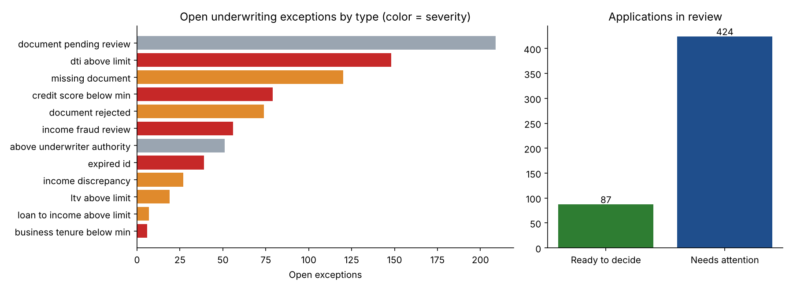

# Loan Operations Workbench on Palantir Foundry + AIP

An operational application for a lending team, designed for **Palantir Foundry**: data pipelines that apply the credit policy to every application, an **Ontology** of applications, exceptions, documents and underwriters, governed **Actions** for every decision, and an **AIP** copilot that summarizes files and drafts borrower communications, **while the underwriter keeps every decision.**

   

> **Data note:** all data is synthetic, produced by [`data/generate_data.py`](data/generate_data.py): 5,000 applicants and loan applications (personal, auto, small business), 14,600 documents, and a 12-person underwriting team. The [credit policy](docs/policy/credit_policy.md) is also fictional. Built-in operational mess includes missing and rejected documents, expired IDs, stated income that doesn't match paystubs, debt-to-income (DTI) near limits, and an aging backlog.

> **What has and hasn't been run:** the policy logic runs locally as a pandas mirror (`make all`), and that run produced the numbers below. The Foundry components (PySpark transforms, Ontology, AIP Logic, AIP Agent, Workshop) are **written and specified here but not yet built in a Foundry environment**. [`docs/BUILD_GUIDE.md`](docs/BUILD_GUIDE.md) walks through building them in the free AIP Developer Tier. Screenshots and a demo video will be added once that's done.

---

## The problem

Underwriters spend much of their day **finding out what's wrong with a file** rather than deciding on it: which document is missing, whether the paystub supports the stated income, whether DTI is over the limit for this product, whether the amount is within their authority. Managers can't see where the backlog is stuck until applications breach SLA.

## What the pipeline found (local run, as of Oct 16 2026)

| | |
|---|---|
| Applications in review | **511** |
| Ready to decide (no open exceptions) | **87 (17%)** |
| Need attention | **424**, with **835 open exceptions** |
| Past the 10-day SLA | **129** |
| Next step is a borrower document request | **23%** of the queue |



| Exception | Severity | Open | Policy | Next action |
|---|---|---|---|---|
| Document pending review | low | 209 | §2 | verify documents |
| DTI above product limit | high | 148 | §1 | decline or counteroffer |
| Missing document | medium | 120 | §2 | request documents |
| Credit score below minimum | high | 79 | §1 | decline or counteroffer |
| Document rejected | medium | 74 | §2 | request documents |
| Stated income > verified by 25%+ | high | 56 | §3 | senior fraud review |
| Above underwriter's authority | low | 51 | §5 | route for second approval |
| Expired government ID | high | 39 | §4 | request documents |

**Operational takeaways:**
- **The largest bucket, pending documents (209), needs a person to look at a document, not a decision.** That makes it a good candidate for document-extraction automation in AIP.
- **87 applications are ready to decide right now.** Surfacing them at the top of the queue is the quickest backlog win.
- **The Consumer team carries 2–4 days of backlog per underwriter, against under 1 day for Small Business** ([workload table](reports/tables/underwriter_workload.csv)), a case for rebalancing assignments.

## Architecture in Foundry

```
 Raw datasets (CSV upload)              Transforms (Code Repository, PySpark)            Ontology                        Applications
 ─────────────────────────              ──────────────────────────────────────           ────────                        ────────────
 applications ─┐
 applicants ───┼─► clean_applications ─► document_checklist ─┐                   ┌─► LoanApplication ◄─┐
 documents ────┼─────────────────────────────────────────────┼─► underwriting_   │   UnderwritingException ├─► Workshop: Loan Ops Workbench
 underwriters ─┤                                             │   exceptions ─────┤   Applicant / Document  │     (queue, file view, manager overview)
 as_of ────────┘                                             └─► loan_applications┘   Underwriter           │
                                                                                     Actions (governed) ───┤─► AIP Logic: triageLoanApplication
                                                                                                           └─► AIP Agent: Underwriting Copilot
```

| Component | Spec / code |
|---|---|
| **Transforms** (PySpark) | [`foundry/transforms-python/src/loanops/datasets/`](foundry/transforms-python/src/loanops/datasets/): four transforms; policy thresholds shared through [`policy.py`](foundry/transforms-python/src/loanops/policy.py) |
| **Ontology** | [`foundry/ontology/ontology.md`](foundry/ontology/ontology.md): 5 object types, 4 links, 7 Actions with submission criteria |
| **AIP Logic** | [`foundry/aip/triage_logic.md`](foundry/aip/triage_logic.md): file summary, policy-grounded next step, borrower email draft, guardrail, eval plan |
| **AIP Agent** | [`foundry/aip/agent.md`](foundry/aip/agent.md): instructions, policy retrieval, tools, deliberately excluded actions, test conversations |
| **Workshop** | [`foundry/workshop/app_design.md`](foundry/workshop/app_design.md): underwriter queue, manager overview, exception explorer |
| **Local mirror** | [`local/loanops/logic.py`](local/loanops/logic.py): the same logic in pandas, unit-tested |

## Design principles

1. **Rules decide, AI drafts.** Policy checks (DTI, credit minimums, documents, income verification, authority limits) are deterministic transforms with a full audit trail. AIP summarizes files, explains which policy applies, and drafts borrower emails, so its output is easy to review and its mistakes are cheap.
2. **Every change goes through an Action.** Approvals are gated in the Action's submission criteria: no open high-severity exceptions, and the amount must be within the user's authority. The UI can't bypass this, and neither can the agent.
3. **The agent can't approve, decline or waive.** Those tools aren't given to it at all. It proposes document requests, resolutions and escalations, each confirmed by a person.
4. **The policy lives in one place.** [`policy.py`](foundry/transforms-python/src/loanops/policy.py) holds the thresholds used by both the Spark transforms and the local mirror, and the [policy document](docs/policy/credit_policy.md) is the agent's retrieval source.
5. **Guardrails on borrower communication.** A non-LLM check blocks any draft that mentions a credit score or internal risk rating (policy §7).

## Repository structure

```
├── data/generate_data.py                       # synthetic lending operations data (CSV → Foundry raw datasets)
├── docs/
│   ├── policy/credit_policy.md                 # fictional credit policy (rules + agent knowledge)
│   └── BUILD_GUIDE.md                          # step-by-step build in the AIP Developer Tier
├── foundry/
│   ├── transforms-python/src/loanops/          # PySpark transforms + shared policy module
│   ├── ontology/ontology.md                    # object types, links, actions
│   ├── aip/triage_logic.md, agent.md           # AIP Logic function + AIP Agent specs
│   └── workshop/app_design.md                  # Workshop app layout
├── local/loanops/                              # pandas mirror of the transforms + local report
├── reports/                                    # metrics.json, figures/, tables/
└── tests/                                      # policy math, checklist, exception and queue tests
```

## Run the local mirror

```bash
git clone https://github.com/chatnic/foundry-loan-ops-aip.git
cd foundry-loan-ops-aip
python -m venv .venv && source .venv/bin/activate
make setup && make all       # generate data -> apply policy -> report -> tests (~10 seconds)
```

Then follow [`docs/BUILD_GUIDE.md`](docs/BUILD_GUIDE.md) to build it in Foundry.

## Credentials

Palantir Foundry Data Engineer · Palantir Foundry & AIP Aware · Palantir AIP AI Engineer

## License

MIT. See [LICENSE](LICENSE).
